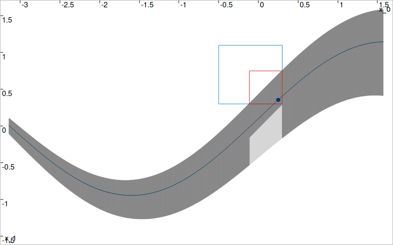
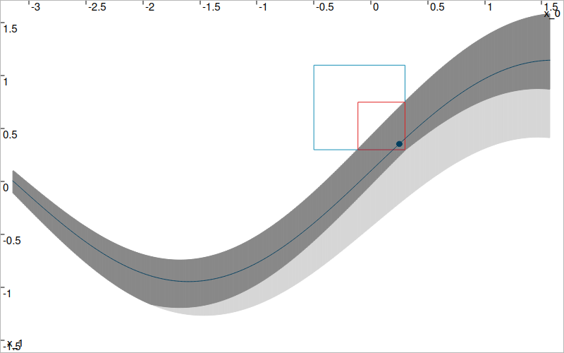
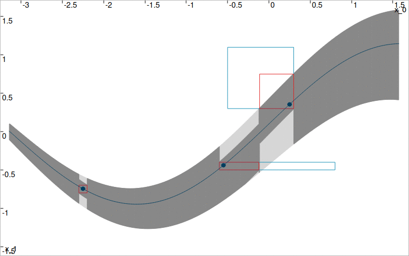
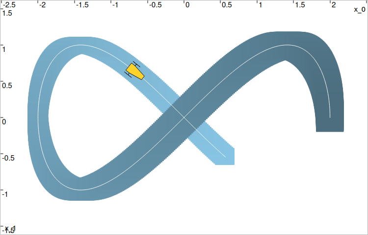
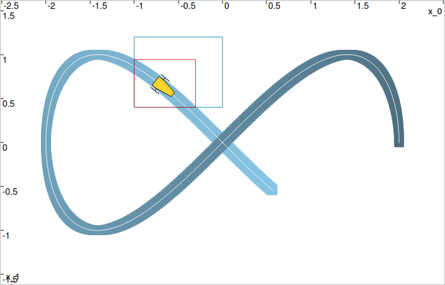

.. _sec-ctc-dynamic-ctceval:

The CtcEval contractor
======================

  Main author: `Simon Rohou <https://www.simon-rohou.fr>`_

.. doxygenclass:: codac2::CtcEval
  :project: codac

The evaluation constraint is particularly useful in state estimation when both
an observation and its acquisition time are uncertain. A position measurement,
for example, may be available only within a time window due to synchronization
errors.

Basic usage
-----------

Consider a trajectory :math:`x(\cdot)` enclosed in a tube :math:`[x](\cdot)`,
its derivative :math:`v(\cdot)` enclosed in :math:`[v](\cdot)`, and an observation
:math:`[t_i]\times[z_i]`. The contractor implements the constraints

.. math::

  \left.\begin{array}{r}
    z_i=x(t_i)\\
    \dot{x}(\cdot)=v(\cdot)
  \end{array}\right\}
  \longrightarrow
  \mathcal{C}_{\mathrm{eval}}\big([t_i],[z_i],[x](\cdot),[v](\cdot)\big).

The observation specifies that the trajectory must visit the set :math:`[z_i]`
at **some** instant in :math:`[t_i]`, not at every instant in this interval.
The derivative bounds constrain the evolution of the trajectory before and after
that instant.

The contractor updates ``t``, ``z`` and ``x`` in place. The derivative tube
``v`` is not contracted, although its shared temporal partition may be refined
by the insertion of gates.

Scalar observation
------------------

The following example models the uncertain derivative of a sinusoidal trajectory
on :math:`[t_0,t_f]=[-\pi,\pi/2]`:

.. math::

  [v](t)=\cos(t)+[-0.1,0.1],\qquad [x](t_0)=[-0.1,0.1].

An initial state tube is built with ``v.primitive()`` using the prescribed
initial interval. A measurement is then supplied in the time-value plane:

.. math::

  [t_i]\times[z_i]=[-0.5,0.3]\times[0.3,1.1].

.. tabs::

  .. group-tab:: Python

    .. literalinclude:: src.py
      :language: py
      :start-after: [ctceval-scalar-beg]
      :end-before: [ctceval-scalar-end]
      :dedent: 4

  .. group-tab:: C++

    .. literalinclude:: src.cpp
      :language: c++
      :start-after: [ctceval-scalar-beg]
      :end-before: [ctceval-scalar-end]
      :dedent: 2

  .. group-tab:: Matlab

    .. literalinclude:: src.m
      :language: matlab
      :start-after: [ctceval-scalar-beg]
      :end-before: [ctceval-scalar-end]

The contraction reduces the possible observation time and value. To understand
why the tube can also be contracted, consider any time :math:`\tau` and a
candidate measurement instant :math:`s\in[t_i]`. A feasible trajectory satisfies

.. math::

  x(\tau)=x(s)+\int_s^{\tau}v(u)\,du.

An enclosure of its possible values at :math:`\tau` can therefore be expressed as

.. math::

  [x](\tau)\ \cap\
  \left[\bigcup_{s\in[t_i]}
    \left(\big([x](s)\cap[z_i]\big)+\int_s^{\tau}[v](u)\,du\right)
  \right],

where the outer square brackets denote an interval hull. This is the continuous
relation underlying the transport of feasible observation values. The sliced
implementation works with the temporal partition and uses derivative-aware
inversion and evaluation, followed by propagation between gates. It is not in
general an exact computation of the continuous feasible set.

  Local contraction of the scalar tube by ``CtcEval``. The light gray region
  shows the part of the tube removed by contraction, and the dark gray region
  shows the remaining tube. The blue and red boxes represent the initial and
  contracted observation, respectively. The curve and dot show a feasible
  trajectory and observation.

Temporal propagation
--------------------

``CtcEval`` first narrows the temporal interval using tube inversion and then
narrows the observed value using tube evaluation. It performs local temporal
propagation within the contracted observation interval. When the time is a
singleton, it can directly update the corresponding gate.

To propagate this information to the rest of the trajectory, apply ``CtcDeriv``
without a temporal restriction:

.. tabs::

  .. group-tab:: Python

    .. literalinclude:: src.py
      :language: py
      :start-after: [ctceval-propagation-beg]
      :end-before: [ctceval-propagation-end]
      :dedent: 4

  .. group-tab:: C++

    .. literalinclude:: src.cpp
      :language: c++
      :start-after: [ctceval-propagation-beg]
      :end-before: [ctceval-propagation-end]
      :dedent: 2

  .. group-tab:: Matlab

    .. literalinclude:: src.m
      :language: matlab
      :start-after: [ctceval-propagation-beg]
      :end-before: [ctceval-propagation-end]

  Global temporal propagation by ``CtcDeriv`` following the local contraction
  by ``CtcEval``. The light gray region shows the part of the initial tube
  removed by the two contractors, and the dark gray region shows the remaining
  tube.

This separation is useful when several measurements constrain the same state
trajectory. Local updates can be collected first, and a single forward/backward
sweep can then propagate their information throughout the tube.

Several observations and partial primitives
-------------------------------------------

Suppose that, in addition to the first scalar measurement, there are two more
observations. Each has its own uncertain time and measured value. All of them
constrain the same ``x`` and ``v``.

For repeated calls, ``CtcEval`` accepts a pair of partial primitives computed
outside the contractor. For :math:`[v](s)=[v^-(s),v^+(s)]`, these tubes enclose

.. math::

  p^-(t)=\int_{t_0}^{t}v^-(s)\,ds,\qquad
  p^+(t)=\int_{t_0}^{t}v^+(s)\,ds.

For certain dates :math:`a\leq b`, the integral of the derivative tube is
bounded by the differences of these primitives:

.. math::

  \int_a^b[v](s)\,ds
  =\big[p^-(b)-p^-(a),\ p^+(b)-p^+(a)\big].

The equality above refers to the exact lower and upper primitives. The
precomputed tubes provide enclosures of these quantities. For backward
integration, the bounds are exchanged and negated. This avoids traversing all
intermediate slices for every transport. See :ref:`sec-tubes-partial-primitives`
for details on this optimization.

In the code below, ``x`` and ``v`` are initialized as in the scalar example,
before any observation is injected. The primitives are computed once and reused
through two sweeps of the observation constraints and the derivative constraint.

.. tabs::

  .. group-tab:: Python

    .. literalinclude:: src.py
      :language: py
      :start-after: [ctceval-multi-beg]
      :end-before: [ctceval-multi-end]
      :dedent: 4

  .. group-tab:: C++

    .. literalinclude:: src.cpp
      :language: c++
      :start-after: [ctceval-multi-beg]
      :end-before: [ctceval-multi-end]
      :dedent: 2

  .. group-tab:: Matlab

    .. literalinclude:: src.m
      :language: matlab
      :start-after: [ctceval-multi-beg]
      :end-before: [ctceval-multi-end]

Precomputation trades memory and initialization cost for faster integration
queries. For short or infrequent observation windows, precomputation is not
necessarily beneficial.

.. note::

  The partial primitives must be recomputed if the derivative envelopes or
  the temporal extent change. Refinement of the shared ``TDomain`` by slice
  duplication preserves their validity but can make the new gate enclosures
  less precise.

  Contraction of a scalar tube using three uncertain observations. The animation
  alternates between local contractions by ``CtcEval`` and the result of global
  temporal propagation by ``CtcDeriv``. The light gray regions show the parts
  of the tube removed by contraction, and the dark gray region shows the
  remaining tube. Blue and red boxes represent the initial and contracted
  observations, respectively.

Two sweeps are used here for illustration. In general, repeat the contractions
until a stopping criterion is met, for instance a negligible reduction in tube
volume and observation widths, or a prescribed iteration budget. A single
sweep does not imply that a fixpoint has been reached.

2d localization example
-----------------------

Contracting the position tube
~~~~~~~~~~~~~~~~~~~~~~~~~~~~~

Consider a robot following a Lissajous-type trajectory over :math:`[0,5]`.
Its initial position is unknown, but its velocity is enclosed by

.. math::

  [\mathbf{v}](t)=
  \begin{pmatrix}-2\sin(t)\\2\cos(2t)\end{pmatrix}
  +[-0.01,0.01]^2.

A position observation gives

.. math::

  [t_i]=[4.3,4.4],\qquad
  [\mathbf{z}_i]=[-0.73,-0.69]\times[0.64,0.68].

The position tube is initially unbounded. The evaluation contractor anchors it
locally, and the derivative contractor propagates this anchor in both time
directions.

.. tabs::

  .. group-tab:: Python

    .. literalinclude:: src.py
      :language: py
      :start-after: [ctceval-localization-beg]
      :end-before: [ctceval-localization-end]
      :dedent: 4

  .. group-tab:: C++

    .. literalinclude:: src.cpp
      :language: c++
      :start-after: [ctceval-localization-beg]
      :end-before: [ctceval-localization-end]
      :dedent: 2

  .. group-tab:: Matlab

    .. literalinclude:: src.m
      :language: matlab
      :start-after: [ctceval-localization-beg]
      :end-before: [ctceval-localization-end]

In this example, the observation alone does not distinguish any time or
position within the original observation box. Its main role is to bound the
position trajectory using the velocity information. The nominal curve
:math:`(2\cos(t),\sin(2t))^\mathsf{T}` is one feasible trajectory.

  Position tube obtained from an initially unbounded tube by combining an uncertain
  position observation with velocity information. The blue gradient represents
  time along the tube. The white curve is a feasible trajectory and the yellow
  robot indicates a feasible pose at the observation time.

Contracting the observation box
~~~~~~~~~~~~~~~~~~~~~~~~~~~~~~~

Conversely, suppose that a position tube is already available:

.. math::

  [\mathbf{x}](t)=
  \begin{pmatrix}2\cos(t)\\\sin(2t)\end{pmatrix}
  +[-0.05,0.05]^2.

The robot is detected somewhere in :math:`[-1,0]\times[0.4,1.2]`, with no
information about its acquisition time except the temporal domain of the tube.
Using the same derivative tube as before, one can estimate when this detection
could have occurred and refine its spatial enclosure:

.. tabs::

  .. group-tab:: Python

    .. literalinclude:: src.py
      :language: py
      :start-after: [ctceval-inversion-beg]
      :end-before: [ctceval-inversion-end]
      :dedent: 4

  .. group-tab:: C++

    .. literalinclude:: src.cpp
      :language: c++
      :start-after: [ctceval-inversion-beg]
      :end-before: [ctceval-inversion-end]
      :dedent: 2

  .. group-tab:: Matlab

    .. literalinclude:: src.m
      :language: matlab
      :start-after: [ctceval-inversion-beg]
      :end-before: [ctceval-inversion-end]

  Contraction of an uncertain position observation using a known position tube.
  The blue and red boxes represent the initial and contracted position domains,
  respectively. The blue gradient represents time along the tube, the white curve
  is a feasible trajectory and the yellow robot indicates a feasible pose at the
  observation time.

When the derivative is unavailable and only the observation domains need to be
refined, use tube inversion and evaluation directly:
``t &= x.invert(z,t)`` and, provided ``t`` is non-empty, ``z &= x(t)``.
These operations do not impose an observation constraint on the tube itself.

Known observation time
----------------------

A known acquisition time :math:`t_i` is represented by a degenerate
``Interval``. If the observation is feasible, the contractor contracts the
observation value and updates the gate of :math:`[x](\cdot)` at :math:`t_i`,
creating it if necessary. No temporal propagation is performed in this case.
Use ``CtcDeriv`` to propagate the information to the rest of the tube.

Related content
---------------

.. admonition:: Related publication

  | **Reliable non-linear state estimation involving time uncertainties**
  | S. Rohou, L. Jaulin, L. Mihaylova, F. Le Bars, S. M. Veres
  | *Automatica*, 93:379--388, July 2018.
  | `DOI: 10.1016/j.automatica.2018.03.074 <https://doi.org/10.1016/j.automatica.2018.03.074>`_
  | `Author manuscript <https://eprints.whiterose.ac.uk/id/eprint/127880/>`_

.. admonition:: Technical documentation

  See the `C++ API documentation of this class <../../../api/html/classcodac2_1_1_ctc_eval.html>`_.
