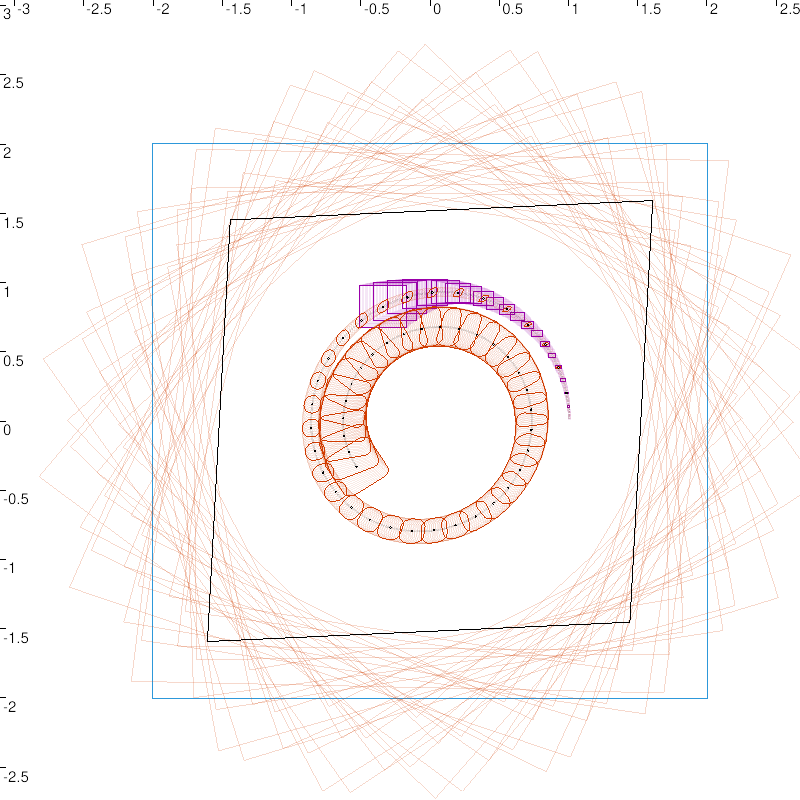
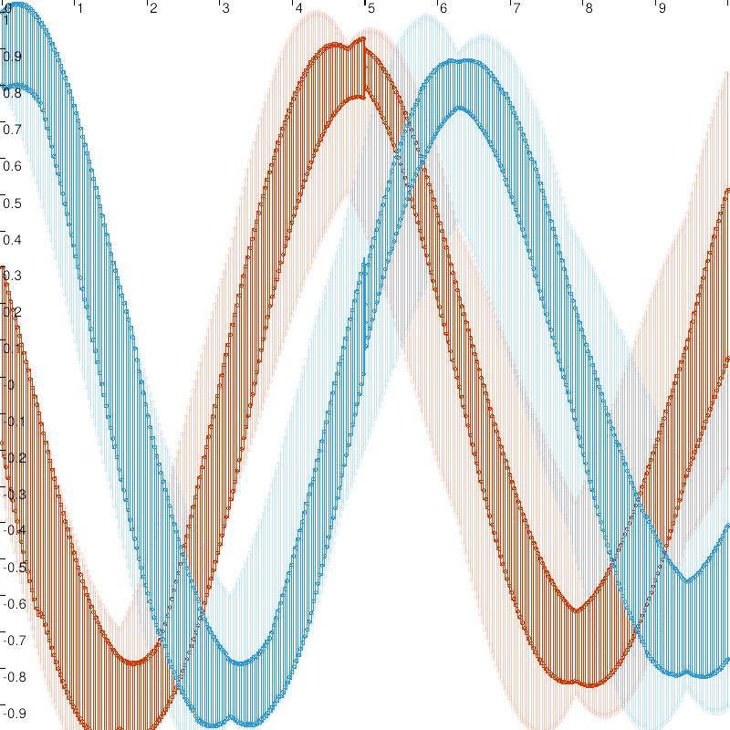

.. _sec-functions-differential-inclusions:

Differential Inclusions
=======================

  Main author: `Damien Massé <https://labsticc.fr/fr/lab-sticc/annuaire/masse-damien>`_

The content of this page is limited to C++. Python bindings are missing for now.

Differential inclusions
-----------------------

Differential inclusions are equations of the form :math:`\dot{\mathbf{x}} \in \big\{ \mathbf{f}\big(t,\mathbf{x},\mathbf{u}\big) \big\}` where :math:`\mathbf{u}` are unknown (possibly non-continuous) functions varying
on a domain :math:`U`.

Codac enables to define differential inclusions and to integrate differential
inclusions. The variables for :math:`\mathbf{x}` and :math:`\mathbf{u}` can
be indifferently ``ScalarVar``, ``VectorVar`` or ``MatrixVar``. The
function :math:`\mathbf{f}` can be any function (linear or not).

For now, two integration schemes are implemented:

- ``RS_box``: a 0-order scheme using boxes (``IntervalVector``), very imprecise
- ``RS_zonotope``: a 1-order scheme using zonotopes, more precise. This scheme requires :math:`\mathbf{f}` to be differentiable (for all its variables).

Examples
--------

Direct integration
~~~~~~~~~~~~~~~~~~

We consider :math:`\mathbf{f}:\mathbb{R}^2 \times \mathbb{R} \to\mathbb{R}^2`:

.. math:: 
  \mathbf{f}((x_1,x_2),u)= (-x_2+u, x_1-0.1 x_2)

We consider :math:`\mathbf{u}` varying in the interval :math:`[-0.03,0.03]`.
The following code performs a guaranteed integration (which constant
time steps) from 
:math:`t=0` to :math:`t=10` using ``RS_box``, starting from a small box
:math:`[1,1.01]\times[0,0.01]` and draws the result.

.. tabs::

  .. group-tab:: C++

    .. literalinclude:: src.cpp
      :language: c++
      :start-after: [1-beg]
      :end-before: [1-end]
      :dedent: 4

The next code performs the same integration using ``RS_zonotope``:

.. tabs::

  .. group-tab:: C++

    .. literalinclude:: src.cpp
      :language: c++
      :start-after: [2-beg]
      :end-before: [2-end]
      :dedent: 4

And this code integrate starting from a large square (the maximum
order of zonotopes is deliberately set to a low value, which means
that the integration is done on parallelepipeds):

.. tabs::

  .. group-tab:: C++

    .. literalinclude:: src.cpp
      :language: c++
      :start-after: [3-beg]
      :end-before: [3-end]
      :dedent: 4

The results  are given below. A black line describes the computation result
when :math:`\mathbf{u}` is 0 (hence the equation is an ODE). The inclusion
of the final set of reachables sets from the large square (in black)
inside the initial set (in blue) proves the stability of the differential
inclusion.

Tube integration
~~~~~~~~~~~~~~~~

Codac enables to generate a tube :class:``~codac.SlicedTube`` from a set
of initial (or final) states, following a temporal domain 
:class:`~codac.TDomain`. The contraction of an existing tube is also provided.
However, since the domain of zonotopes does not admit useful intersection
operators, the contraction is not very efficient for now. An example is
given below:

.. tabs::

  .. group-tab:: C++

    .. literalinclude:: src.cpp
      :language: c++
      :start-after: [4-beg]
      :end-before: [4-end]
      :dedent: 4

The resulting plot is shown below.

