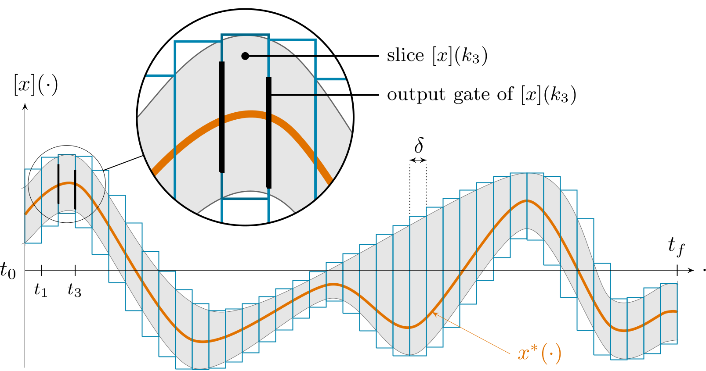

.. _sec-tubes-trajectories:

Tubes & Trajectories
====================

  Main author: `Simon Rohou <https://www.simon-rohou.fr/research/>`_

Codac provides trajectories to represent time-dependent values and tubes to represent time-dependent sets.

| A trajectory :math:`x(\cdot):[t_0,t_f]\rightarrow\mathbb{R}^n` associates a single value with each time.
| A tube is a set-valued function defined as

.. math::

   [x](\cdot):[t_0,t_f]\rightarrow\mathcal{P}(\mathbb{R}^n),

where :math:`\mathcal{P}(\mathbb{R}^n)` denotes the power set of :math:`\mathbb{R}^n`. In Codac, these sets are represented by a configurable domain type, such as a box or a polygon.

.. _sec-trajectories:

Trajectories
------------

Two representations are available. ``SampledTraj`` stores time/value samples and interpolates linearly between them, while ``AnalyticTraj`` evaluates expressions of time through an ``AnalyticFunction``. Both support scalar, vector and matrix trajectories.

Trajectories are intended to represent approximations of solutions or measured signals. Guaranteed computations involving time-dependent quantities rely on tubes to account for uncertainties.

.. toctree::
   :maxdepth: 1

   sampledtraj
   analytictraj
   trajectory_operations
   trajectory_io

.. _sec-tubes:

Tubes
-----

A ``SlicedTube`` represents a tube over a temporal partition :class:`~codac.TDomain`. Each time element is a :class:`~codac.TSlice`, with an associated :class:`~codac.Slice` for each tube. Several tubes may share one temporal partition, so refining it also updates the structure of the other tubes.

The principal codomains are ``Interval``, ``IntervalVector`` and ``IntervalMatrix``, which represent scalar, vector and matrix sliced tubes. For these sliced tubes, contractors can reduce the enclosures using observations and dynamical constraints without discarding feasible trajectories, making them particularly useful for guaranteed state estimation.

   A sliced tube :math:`[x](\cdot)`, represented by interval enclosures over a temporal partition.

C++ also supports compatible custom codomains, such as ``ConvexPolygon`` or ``Ellipsoid``.

.. toctree::
   :maxdepth: 1

   tdomain
   slice
   slicedtube
   tube_examples

See also :ref:`sec-tools-serialization` and :doc:`../visualization/functions`.
